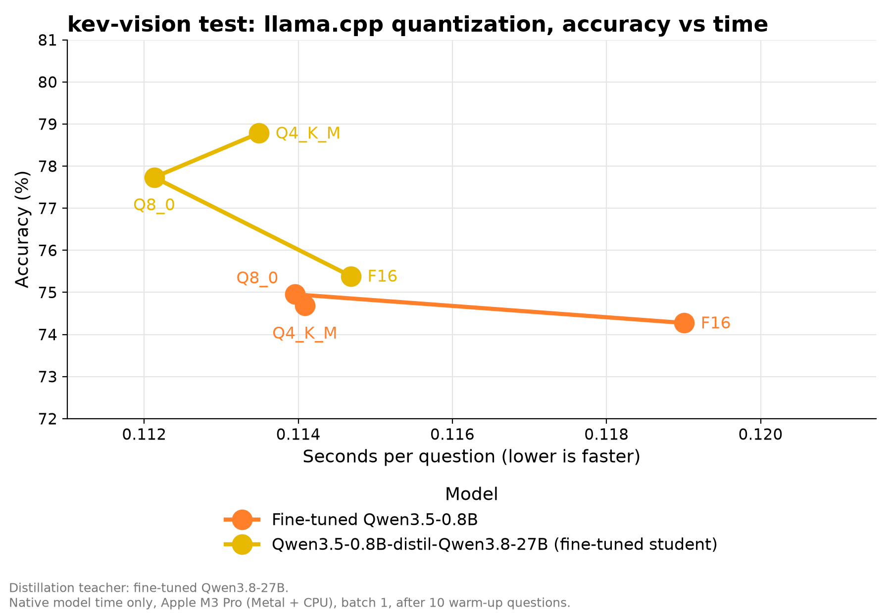
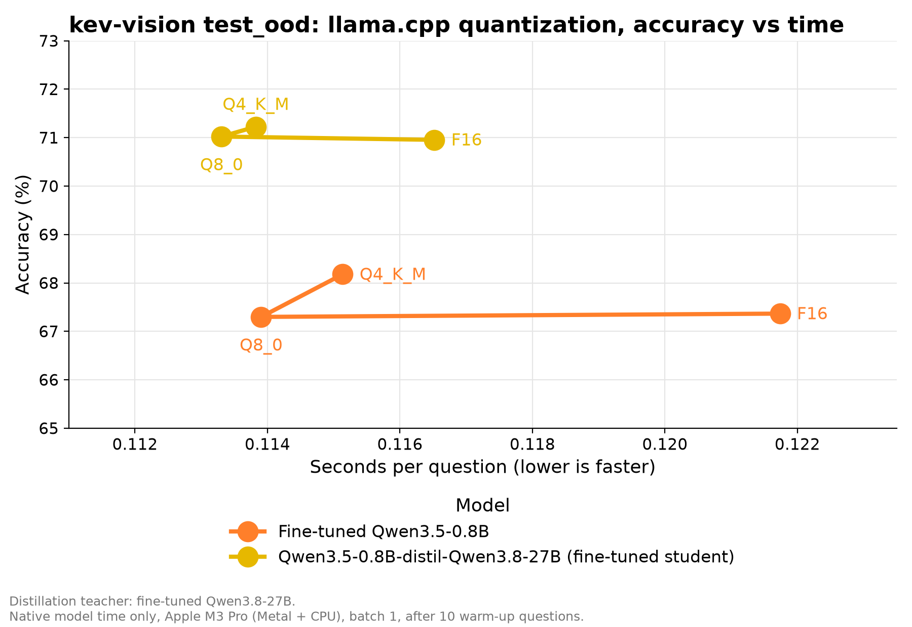

<p align="center">
  
</p>

<h2 align="center">IMA: Instant Multimodal Answers</h2>

<p align="center"><em>A decoder-based image-text System One model</em></p>

<p align="center">
  <a href="https://www.repostatus.org/#active"></a>
</p>


## What is a System One model?
A System One model answers in one fast step, like a gut feeling. It does not
think in text first. The opposite, "System Two", writes its reasoning and then
the answer. It is slower. IMA is a System One model.

## How IMA works
IMA is built on a pretrained multimodal LLM (Hugging Face). It answers typed
questions about a state (text and images) in one forward pass, with no text
generation.

1. Each question becomes a lettered prompt: images, state, question, and
   options (`A. ...`, `B. ...`).
2. The model runs one forward pass. Only the logits of the option letters
   at the answer position are kept.
3. A softmax with a global temperature turns them into one probability per
   option. The temperature is fitted after training (calibration).

### What it accepts
A request has a `state` (text), up to eight images in `files` (base64 image
data URLs) and one or more `questions`. Each question has a type:
- `noul`: yes or no. Returns the probability of "yes".
- `choice`: one option out of many (up to 26). Returns the best option, a
  confidence and the probability of each option.
- `score`: ordered levels (2 to 10 in the API). Returns the expected level,
  a confidence and the probability of each level.

## Install
Needs Python 3.11+ and [uv](https://docs.astral.sh/uv/).

```bash
uv sync
```

The training dataset is gated. Log in first with `hf auth login`.

## Usage

### Train
Training uses LoRA on the language model, then fits the temperature. The
merged model goes to `<output_dir>/final`. Change any config value with
`--section.key value`.

```bash
uv run python -m src.training.train configs/train/qwen3_5_0_8b.yml
```

### Inference
```python
from src.pipeline.system_one import SystemOnePipeline

# a trained model, or a raw backbone id for zero-shot answers
pipeline = SystemOnePipeline.from_pretrained("runs/qwen3_5_0_8b/final")
response = pipeline({
    "state": "A customer writes: 'I was charged twice this month.'",
    "files": [],
    "questions": {
        "billing": {"type": "noul", "instructions": "Is it about billing?"},
        "tone": {
            "type": "choice",
            "instructions": "What is the tone?",
            "criteria": {"calm": None, "angry": None, "sad": None},
        },
    },
})
```

### Test
Prints and saves accuracy, Brier score, ECE and seconds per question.

```bash
uv run python -m src.testing.test configs/test/qwen3_5_0_8b.yml
```

### GGUF export and server
Export a merged model (the `final/` directory) for llama.cpp. Build llama.cpp
first (needs Git, CMake and a C++ compiler):

```bash
git clone https://github.com/ggml-org/llama.cpp.git ../llama.cpp
git -C ../llama.cpp checkout c0fd78626405c6d9b934efef0ec7291fcc20e3d6
cmake -S ../llama.cpp -B ../llama.cpp/build -DCMAKE_BUILD_TYPE=Release
cmake --build ../llama.cpp/build --config Release --target llama-server llama-quantize -j 4
uv sync --extra llamacpp
```

Add `-DGGML_CUDA=ON` to the first `cmake` command for NVIDIA GPUs. Then
export and serve:

```bash
uv run --extra llamacpp python -m src.llamacpp.export runs/qwen3_5_0_8b/final exports/qwen3_5_0_8b --llama-cpp-dir ../llama.cpp
python -m src.llamacpp.serve exports/qwen3_5_0_8b --llama-cpp-dir ../llama.cpp
```

Use `--quantization Q8_0` or `Q4_K_M` on the export for a smaller model. The
server listens on `127.0.0.1:8080` and exposes `POST /v1/systemone`. See
[docs/LLAMACPP.md](docs/LLAMACPP.md) for details, and
[examples/snake/README.md](examples/snake/README.md) for a demo that uses it.

You can test a GGUF export with
`configs/test/qwen3_5_0_8b_llamacpp.yml`.

## Results
All models were trained on the `Jacqkues/kev-vision-decisions-full`
dataset ([dataset card](https://huggingface.co/datasets/Jacqkues/kev-vision-decisions-full)),
and tested on its `test` and `test_ood` splits:

| Backbone | Model | Mode | Test set | Accuracy | Brier | ECE | Seconds/question |
|---|---|---|---|---|---|---|---|
| Qwen3.5-0.8B | zero-shot | System Two | `test` | 49.7% | 0.623 | 0.266 | 2.156 |
| Qwen3.5-0.8B | zero-shot | System One | `test` | 52.1% | 0.512 | 0.100 | 0.078 |
| Qwen3.5-0.8B | fine-tuned | System One | `test` | 75.4% | 0.262 | 0.031 | 0.083 |
| Qwen3.5-0.8b-distil-Qwen3.8-27b | distilled (base student) | System One | `test` | 76.9% | 0.259 | 0.042 | 0.081 |
| Qwen3.5-0.8b-distil-Qwen3.8-27b | distilled (fine-tuned student) | System One | `test` | 77.9% | 0.255 | 0.059 | 0.077 |
| Qwen3.8-27B | zero-shot | System Two | `test` | 62.9% | 0.497 | 0.232 | 4.857 |
| Qwen3.8-27B | zero-shot | System One | `test` | 65.2% | 0.427 | 0.122 | 0.129 |
| Qwen3.8-27B | fine-tuned | System One | `test` | 79.2% | 0.218 | 0.037 | 0.194 |
| Qwen3.5-0.8B | zero-shot | System Two | `test_ood` | 60.4% | 0.477 | 0.143 | 2.293 |
| Qwen3.5-0.8B | zero-shot | System One | `test_ood` | 58.6% | 0.505 | 0.049 | 0.088 |
| Qwen3.5-0.8B | fine-tuned | System One | `test_ood` | 68.3% | 0.414 | 0.031 | 0.070 |
| Qwen3.5-0.8b-distil-Qwen3.8-27b | distilled (base student) | System One | `test_ood` | 67.9% | 0.399 | 0.028 | 0.090 |
| Qwen3.5-0.8b-distil-Qwen3.8-27b | distilled (fine-tuned student) | System One | `test_ood` | 70.3% | 0.415 | 0.083 | 0.063 |
| Qwen3.8-27B | zero-shot | System Two | `test_ood` | 82.2% | 0.212 | 0.075 | 3.977 |
| Qwen3.8-27B | zero-shot | System One | `test_ood` | 74.5% | 0.338 | 0.046 | 0.147 |
| Qwen3.8-27B | fine-tuned | System One | `test_ood` | 89.4% | 0.158 | 0.015 | 0.157 |

Both distilled models use the fine-tuned Qwen3.8-27B teacher. The labels
refer to the student's starting weights: the pretrained base model or an
adapter already fine-tuned on the task.

`test_ood` holds sources not seen in training.

Accuracy against time per question, one graph per test set:


### Quantization (llama.cpp)

Measured locally on Apple M3 Pro (Metal + CPU). Accuracy includes all
evaluated questions; mean seconds per question is native model time after
the first 10 warm-up questions. `test` evaluated 4,855 questions and skipped
64 choice questions with more than 26 options. `test_ood` evaluated all
1,477 questions.

| Model | Quant. | Split | Accuracy | Brier | ECE | s/question |
|---|---|---|---:|---:|---:|---:|
| Fine-tuned | F16 | `test` | 74.3% | 0.262 | 0.020 | 0.119 |
| Fine-tuned | F16 | `test_ood` | 67.4% | 0.414 | 0.049 | 0.122 |
| Fine-tuned | Q8_0 | `test` | 75.0% | 0.262 | 0.026 | 0.114 |
| Fine-tuned | Q8_0 | `test_ood` | 67.3% | 0.414 | 0.050 | 0.114 |
| Fine-tuned | Q4_K_M | `test` | 74.7% | 0.264 | 0.025 | 0.114 |
| Fine-tuned | Q4_K_M | `test_ood` | 68.2% | 0.415 | 0.029 | 0.115 |
| distilled (fine-tuned student) | F16 | `test` | 75.4% | 0.254 | 0.041 | 0.115 |
| distilled (fine-tuned student) | F16 | `test_ood` | 71.0% | 0.411 | 0.078 | 0.117 |
| distilled (fine-tuned student) | Q8_0 | `test` | 77.7% | 0.254 | 0.057 | 0.112 |
| distilled (fine-tuned student) | Q8_0 | `test_ood` | 71.0% | 0.412 | 0.078 | 0.113 |
| distilled (fine-tuned student) | Q4_K_M | `test` | 78.8% | 0.255 | 0.070 | 0.113 |
| distilled (fine-tuned student) | Q4_K_M | `test_ood` | 71.2% | 0.418 | 0.084 | 0.114 |





## License

The original source code in this repository is licensed under the
[Apache License 2.0](LICENSE).

Datasets and model weights, including trained adapters and checkpoints, are
excluded from this code license and require separate license terms. The
`Jacqkues/kev-vision-decisions-full` dataset requires non-commercial research
use and compliance with each source's license; see its
[dataset card](https://huggingface.co/datasets/Jacqkues/kev-vision-decisions-full).
